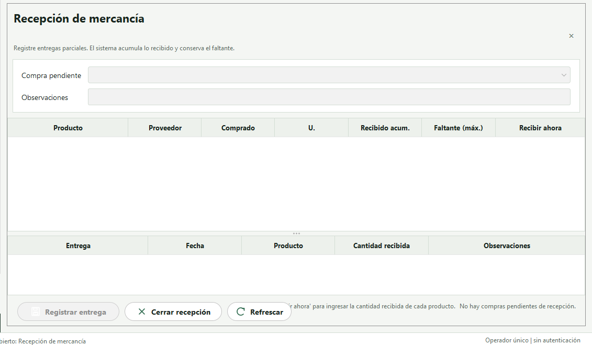

<div align="center">

# 🌱 Sistema de Control Operativo AGROMEDIO

**Aplicación de escritorio para apoyar la gestión operativa de la Asociación Agropecuaria y Ambiental del Magdalena Medio.**

Carga de instrucciones · Compras · Recepción · Alistamiento · Despacho · Reportes

</div>

---

## 📌 Acerca del proyecto

AGROMEDIO es un prototipo académico de escritorio que permite organizar el ciclo operativo de los mercados: desde la recepción de instrucciones en archivos hasta la verificación de los productos despachados. La aplicación conserva el historial de cada operación y ayuda a consultar cantidades solicitadas, compradas, recibidas, alistadas y despachadas.

**Proyecto Integrador** de las Unidades Tecnológicas de Santander, desarrollado en el marco de las asignaturas TSI304 Planeación de Sistemas Informáticos, TSI301 Motores de Bases de Datos y TSI302 Programación Orientada a Objetos.

**Equipo del proyecto:** Santiago Colmenares Parra, Iván Mauricio Califa Hernández, Jorge Andrés Correa Morales y Jaider Martínez.

## 🧭 Contenido

- [Funciones principales](#-funciones-principales)
- [Roles operativos](#-roles-operativos)
- [Modelo de datos](#-modelo-de-datos)
- [Estructura del repositorio](#-estructura-del-repositorio)
- [Requisitos](#-requisitos)
- [Clonar, compilar y ejecutar](#-clonar-compilar-y-ejecutar)
- [Pruebas automatizadas](#-pruebas-automatizadas)
- [Abrir en NetBeans](#-abrir-en-netbeans)
- [Base de datos](#-base-de-datos)
- [Formatos de entrada](#-formatos-de-entrada)
- [Visuales](#-visuales)
- [Documentación](#-documentación)
- [Créditos](#-créditos)

## ✨ Funciones principales

- Importar instrucciones de operación desde Excel, CSV o TXT.
- Crear y consultar plantillas operativas para cada mercado y fecha.
- Consolidar productos requeridos y registrar compras a proveedores.
- Registrar entregas parciales y consultar faltantes acumulados.
- Controlar el alistamiento de productos por mercado.
- Verificar los productos de cada despacho y registrar novedades cuando corresponda.
- Consultar reportes de saldos, faltantes de recepción y consolidado de productos.
- Administrar catálogos de clientes, categorías, unidades de medida, proveedores y productos.

El flujo de una plantilla avanza por los estados **CARGADA → EN_COMPRA → RECIBIENDO → ALISTANDO → LISTA → DESPACHADA**. El sistema aplica validaciones para evitar transiciones y cierres operativos inválidos.

## 👥 Roles operativos

Los roles describen responsabilidades dentro del proceso. **Esta versión es monousuario: los roles no son cuentas de usuario y la aplicación no implementa autenticación ni permisos diferenciados.**

| Rol | Responsabilidades principales |
|---|---|
| **Coordinador de operaciones** | Carga las instrucciones, consulta el avance de la jornada y administra catálogos. |
| **Gerente de compras** | Consulta el consolidado de productos y registra compras y proveedores. |
| **Operador de recepción** | Registra las entregas recibidas, incluidas las parciales, y sus faltantes. |
| **Operador de alistamiento** | Prepara y marca como completados los productos de cada mercado. |
| **Operador de despacho** | Verifica cada producto, registra novedades y confirma la salida del mercado. |
| **Sistema** | Valida reglas operativas, mantiene estados y calcula saldos y faltantes. |

## 🗃️ Modelo de datos

La base de datos SQLite organiza la información en tablas relacionadas por llaves foráneas. A continuación se resumen las entidades principales; el [diccionario de datos](docs/08_diccionario_datos.md) contiene columnas, restricciones y relaciones en detalle.

| Área | Tablas | ¿Qué registran? |
|---|---|---|
| **Catálogos** | `cliente`, `categoria`, `unidad_medida`, `proveedor`, `producto` | Entidades y datos maestros usados durante la operación, con las unidades y factores de conversión de productos. |
| **Carga y demanda** | `carga_plantilla`, `plantilla_operativa`, `detalle_plantilla` | Archivos procesados, mercados programados y productos con sus cantidades solicitadas. El hash SHA-256 de la carga ayuda a evitar duplicados. |
| **Compras y recepción** | `compra`, `detalle_compra`, `distribucion_compra`, `recepcion`, `detalle_recepcion` | Compras, productos y proveedores asociados, distribución de cantidades entre plantillas y entregas recibidas con faltantes acumulados. |
| **Alistamiento y despacho** | `alistamiento`, `detalle_alistamiento`, `despacho`, `detalle_despacho` | Preparación de productos y verificación de cada ítem al momento de despachar un mercado. |

El esquema también incluye vistas de consulta para el **saldo de cada plantilla** (`v_saldo_plantilla`), los **faltantes de recepción** (`v_faltantes_recepcion`) y el **avance del despacho** (`v_avance_despacho`).

## 📁 Estructura del repositorio

| Carpeta | Contenido |
|---|---|
| `AgromedioApp/` | Proyecto NetBeans, código fuente Java, configuración de Ant y librerías en `lib/`. |
| `docs/` | Informe técnico, trazabilidad, pruebas, casos de uso, manual, diccionario de datos, guiones SQL y capturas. |

## ⚙️ Requisitos

- Java JDK 17 o superior (`java -version`).
- Apache Ant para compilar. Puede usarse el incluido con NetBeans 21; las instrucciones siguientes muestran la ruta habitual en Windows.

## 🚀 Clonar, compilar y ejecutar

En **PowerShell**:

```powershell
# 1. Clonar el repositorio y entrar al proyecto
git clone https://github.com/Mauricio-Khalifa/agromedio-control-operativo.git
cd agromedio-control-operativo\AgromedioApp

# 2. Compilar y generar dist\AgromedioApp.jar
& "C:\Program Files\NetBeans-21\netbeans\extide\ant\bin\ant.bat" jar

# 3. Ejecutar (PowerShell requiere comillas alrededor de -D)
java "-Dfile.encoding=UTF-8" -jar dist\AgromedioApp.jar
```

En **CMD**:

```cmd
cd agromedio-control-operativo\AgromedioApp
"C:\Program Files\NetBeans-21\netbeans\extide\ant\bin\ant.bat" jar
java -Dfile.encoding=UTF-8 -jar dist\AgromedioApp.jar
```

También se puede iniciar con doble clic en `AgromedioApp\ejecutar.bat`.

> **Nota para PowerShell:** si aparece `Error: Could not find or load main class .encoding=UTF-8`, ejecuta el comando con las comillas tal como se muestra: `java "-Dfile.encoding=UTF-8" -jar dist\AgromedioApp.jar`.

## 🧪 Pruebas automatizadas

Desde PowerShell, en la carpeta `AgromedioApp`:

```powershell
& "C:\Program Files\NetBeans-21\netbeans\extide\ant\bin\ant.bat" pruebas
& "C:\Program Files\NetBeans-21\netbeans\extide\ant\bin\ant.bat" pruebas-vistas
```

**Resultado documentado:** 65/65 pruebas en verde (20 de esquema, 32 de lógica y 13 de vistas).

## 💻 Abrir en NetBeans

Selecciona **Archivo → Abrir proyecto…** y elige la carpeta `AgromedioApp`. La clase principal es `agromedio.presentacion.Aplicacion`; ejecuta con **Run / F6**.

## 🛢️ Base de datos

La aplicación usa **SQLite**. En el primer inicio crea y carga automáticamente la base de datos desde `AgromedioApp/src/sql/schema.sql` y `AgromedioApp/src/sql/seed.sql`. Las copias de consulta están en `docs/base_de_datos/`.

## 📄 Formatos de entrada

- **Excel:** `.xlsx` y `.xls` (se procesa la primera hoja).
- **Archivos planos:** `.csv` y `.txt` en UTF-8, con delimitador `;`, `,` o tabulador.
- **Columnas requeridas:** `Cliente`, `Contacto`, `Telefono`, `Mercado`, `Fecha`, `Producto`, `Cantidad`.
- **Fechas aceptadas:** formato de Excel, `aaaa-mm-dd` o `dd/mm/aaaa`.
- **Cantidades:** admite números y textos como `9 unidades`, `1 de 300 gr`, `2 de 1000 ml`, `400 gramos`, `1 libra`, `0.25 libra` o `1 rama`.
- Si un producto no existe, puede crearse automáticamente en el catálogo con la unidad detectada y la presentación entre paréntesis cuando aplica.
- Cada archivo se identifica mediante SHA-256; al intentar cargar de nuevo el mismo archivo, la aplicación informa **“Carga ya realizada”**.

## 🖼️ Visuales

Capturas actualizadas de los módulos de la aplicación:

### Menú de navegación


### Carga de plantillas


### Procesos abiertos


### Seguimiento de plantillas abiertas


### Compras


### Recepción



### Alistamiento y recepción


### Despacho


## 📚 Documentación

- [Índice de documentos](docs/README.md)
- [Casos de uso y actores](docs/04_casos_uso.md)
- [Manual de usuario](docs/05_manual_usuario.md)
- [Diccionario de datos](docs/08_diccionario_datos.md)
- [Esquema de base de datos](docs/base_de_datos/schema.sql)
- [Datos de demostración](docs/base_de_datos/seed.sql)

## Créditos
! Este proyecto fue desarrollado integrando los conocimientos de las materias 
Planeacion de sistemas informaticos 
Motores de bases de datos 
Programacion Orientada a objetos 

Por los estudiantes en formacion:
Santiago Colmenares Parra 
Iván Mauricio Califa 
Jorge Andrés Correa Morales 
Jaider David Martínez Ditta
