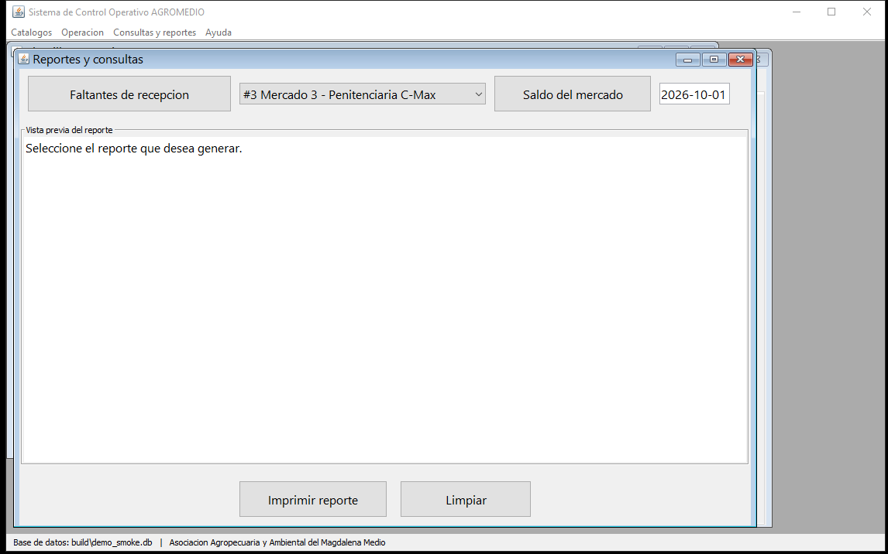

# Manual de Usuario

**Sistema de Control Operativo AGROMEDIO**  
**Versión 1.1 – octubre 2026**

---

## 1. Requisitos previos

- Computador con **Windows** y **Java 17 o superior** instalado (`java -version` en una terminal debe responder).
- El sistema usa una base de datos local SQLite; no necesita un servidor de base de datos.

## 2. Instalación

1. Copie la carpeta `AgromedioApp` completa al equipo de planta (o utilice la copia ya instalada).
2. Verifique que existan `dist\AgromedioApp.jar` y la carpeta `dist\lib` con los archivos `.jar`.
3. Si no existe el paquete, genere el proyecto desde una terminal en su carpeta:
   ```
   "C:\Program Files\NetBeans-21\netbeans\extide\ant\bin\ant.bat" jar
   ```

## 3. Inicio del sistema

1. Haga doble clic en **`ejecutar.bat`** (también puede iniciar `dist\AgromedioApp.jar` si Windows tiene Java asociado a los `.jar`).
2. En el primer inicio se crea la base local y se cargan los datos iniciales definidos por el sistema.
3. En la ventana principal puede abrir módulos desde el menú superior o desde los botones de navegación laterales.



*Figura 1. Ventana principal y módulos de trabajo.*

**Base de datos:** la barra inferior indica que la base local está conectada, pero no muestra su ruta directamente. Consulte **Ayuda → Acerca del sistema** para verla. Por defecto el archivo se llama `agromedio.db` y queda en el directorio desde el que se inicia la aplicación; la ruta puede configurarse al arrancar.

## 4. Navegación y menús

| Menú superior | Opciones principales | Función |
|---|---|---|
| **Operación** | Plantillas operativas · Carga desde archivo (Módulo 0) · Compras (Módulo 1) · Recepción (Módulo 2) · Alistamiento / Producción (Módulo 3) · Despacho (Módulo 4) | Gestión del ciclo operativo |
| **Catálogos** | Clientes · Categorías · Unidades de medida · Proveedores · Productos | Consulta y mantenimiento de datos maestros |
| **Consultas y reportes** | Reportes operativos | Consulta e impresión de reportes |
| **Ayuda** | Acerca del sistema | Información del sistema y ruta de la base de datos |
| **Ventana** | Cerrar ventana activa · Cerrar todas las ventanas | Gestión de las ventanas abiertas |
| **Resumen** | Procesos abiertos | Consulta del estado de los procesos |

En la navegación lateral aparecen también accesos directos a **Carga de archivo**, **Plantillas**, **Compras**, **Recepción**, **Alistamiento**, **Despacho**, los catálogos y **Reportes**. Las ventanas de los módulos se abren dentro del área de trabajo y se pueden cerrar individualmente.

> **Precaución:** el menú **Pruebas → Limpiar datos operativos** elimina plantillas y registros de operación (cargas, compras, recepciones, alistamientos y despachos); conserva los catálogos. No lo use durante el trabajo normal.

## 5. Flujo operativo paso a paso

El ciclo previsto para una plantilla es:

```
CARGADA → EN_COMPRA → RECIBIENDO → ALISTANDO → LISTA → DESPACHADA
```

La aplicación también permite registrar pedidos de compra consolidados por fecha y distribuidos internamente entre plantillas. En ese flujo, guardar el pedido consolidado no necesariamente cambia de inmediato el estado de cada plantilla a `EN_COMPRA`; la recepción registrada las lleva a `RECIBIENDO` y al cerrar la recepción pasan a `ALISTANDO`.

### 5.1 Paso 0 – Cargar instrucciones desde archivo (Módulo 0)

1. Abra **Operación → Carga desde archivo (Módulo 0)** (o **Carga de archivo** en la navegación lateral).
2. Pulse **Seleccionar archivo** y elija el archivo administrativo (`.xlsx`, `.xls`, `.csv` o `.txt`). En Excel se procesa la primera hoja.
3. Pulse **Cargar en el sistema**. Revise el resumen de la carga y el detalle de las filas con error u observaciones. El sistema puede crear productos que aún no estén en el catálogo.
4. Si el mismo contenido de archivo ya se cargó y sus plantillas siguen registradas, el sistema avisa **“Carga ya realizada”** y no vuelve a importarlo. Para reintentar un archivo corregido, guárdelo con el contenido corregido y vuelva a seleccionarlo.
5. Revise las plantillas importadas en **Operación → Plantillas operativas**. Seleccione una y pulse **Ver detalle** (también puede hacer doble clic en la fila).

**Formato del archivo:** use estas columnas, en este orden:

| N.º | Columna | Contenido |
|---:|---|---|
| 1 | `Cliente` | Nombre de la entidad o cliente |
| 2 | `Contacto` | Contacto (puede quedar vacío) |
| 3 | `Telefono` | Teléfono (puede quedar vacío) |
| 4 | `Mercado` | Nombre del mercado |
| 5 | `Cant. Mercados` | Número entero mayor que cero |
| 6 | `Fecha` | Fecha programada, preferiblemente `aaaa-mm-dd`; también se admite `dd/mm/aaaa` |
| 7 | `Producto` | Nombre del producto |
| 8 | `Cantidad` | Cantidad numérica o expresión descriptiva |
| 9 | `Unidad` | Unidad opcional si la cantidad se expresa como número simple |

Aunque las primeras instrucciones del sistema muestran un formato resumido de siete campos, la lógica de importación actual lee **nueve posiciones**: `Cant. Mercados` se ubica en la quinta columna y `Unidad` en la novena. Use el orden de la tabla para evitar que los campos se interpreten en la columna equivocada. Para cada mercado/fecha, incluya una sola fila por producto y presentación; una fila duplicada de producto en la misma plantilla no se suma.

En CSV/TXT se admite UTF-8 con o sin BOM, delimitador punto y coma (`;`), coma (`,`) o tabulador, y campos entre comillas. Ejemplos de cantidad descriptiva: `9 unidades`, `1 de 300 gr`, `2 de 1000 ml`, `400 gramos`, `1 libra`, `0.25 libra` o `1 rama`. Si indica una unidad en la novena columna, escriba la cantidad como número y la unidad en esa columna. Una cantidad descriptiva puede generar un producto con la presentación especificada entre paréntesis.

### 5.2 Paso 1 – Compras (Módulo 1)

1. Abra **Operación → Compras**.
2. En **Consolidado de demanda (RF03)**, indique la **Fecha programada** y pulse **Actualizar consolidado**. El sistema muestra los productos pendientes de compra y la demanda agregada de los mercados de esa fecha.
3. Seleccione un producto pendiente y pulse **Preparar compra pendiente** (o haga doble clic en el producto). Se abre **Registrar compra** con el producto y una cantidad sugerida en unidad de compra; revise y ajuste los datos.
4. Seleccione el **Proveedor**, confirme la **Cantidad (en su unidad de compra)** y el **Costo total del pedido**. Pulse **Agregar item** para incorporar cada producto al pedido. Un mismo producto no debe repetirse dentro del pedido de un proveedor.
5. Pulse **Guardar compra**. La aplicación registra uno o más pedidos, agrupados automáticamente por proveedor. La cantidad comprada no puede exceder la demanda pendiente consolidada.
6. Use las pestañas **Productos comprados / Pedidos** y **Seguimiento por plantilla** para revisar pedidos y cantidades compradas, recibidas, alistadas y despachadas.

> **Importante:** en la pantalla actual el proveedor se asigna a cada producto; el sistema agrupa los productos por proveedor al guardar. No hay una lista de chequeo de “producto adquirido” en tiempo real en esta pantalla. La compra exige al menos un producto, proveedor y cantidad mayor que cero; los productos duplicados en un pedido se rechazan.

### 5.3 Paso 2 – Recepción (Módulo 2)

1. Abra **Operación → Recepción** y seleccione una **Compra pendiente**.
2. En la columna **Recibir ahora**, escriba cuánto llegó de cada producto en la unidad mostrada. La tabla también muestra lo comprado, lo recibido acumulado y el **Faltante (máx.)** permitido para esta entrega.
3. Pulse **Registrar entrega**. Registre solo las cantidades recibidas en esta tanda; se admite recepción parcial y el acumulado/faltante se actualiza. No se puede registrar una cantidad negativa ni mayor que el faltante. Debe ingresar al menos una cantidad positiva.
4. Si hay otra tanda, vuelva a ingresar las cantidades que llegan y pulse **Registrar entrega**. El historial de entregas queda visible en la parte inferior de la ventana.
5. Cuando termine, pulse **Cerrar recepción**. Si aún hay faltantes, confirme si desea cerrar de todos modos; estos quedarán registrados. La compra se cierra y las plantillas asociadas pasan a `ALISTANDO`.

> Los faltantes de recepción se consultan en **Consultas y reportes → Reportes operativos → Ver faltantes**. El reporte no requiere seleccionar un proveedor.

### 5.4 Paso 3 – Alistamiento / Producción (Módulo 3)

1. Abra **Operación → Alistamiento / Producción** (o **Alistamiento** en la navegación lateral) y seleccione la plantilla.
2. Si el alistamiento aún no existe, pulse **Iniciar alistamiento**. El sistema crea las tareas con los productos de la plantilla y muestra lo solicitado y lo recibido.
3. Para cada producto, registre la **Cantidad alistada** y marque **Completado** cuando haya terminado de fraccionarlo y empacarlo. La cantidad alistada no puede superar lo recibido ni lo solicitado; no se puede completar un producto sin recepción ni con cantidad cero.
4. Pulse **Guardar avance** para guardar el progreso sin cerrar el alistamiento.
5. Cuando todos los productos estén completados, pulse **Completar alistamiento**. Si falta alguno, el sistema no lo cierra y señala que quedan productos por completar. Al completar, la plantilla pasa a `LISTA`.

### 5.5 Paso 4 – Despacho (Módulo 4)

1. Abra **Operación → Despacho**, seleccione un **Mercado listo** y pulse **Abrir lista**.
2. Revise cada fila. La lista muestra lo solicitado, la **Cantidad a despachar**, **Verificado** y **Faltante aceptado**. La cantidad inicial se basa en lo alistado disponible; edítela si corresponde.
3. Seleccione una fila y pulse **Verificar ítem** cuando haya comprobado físicamente ese producto en la bolsa o cesta. Para corregir una verificación, use **Desmarcar ítem**. La cantidad verificada debe ser mayor que cero y no superar lo disponible ni lo solicitado.
4. Si se despacha una cantidad parcial, marque **Faltante aceptado** en esa fila. El faltante aceptado debe ser parcial (no puede ser cero despachado); indique la novedad que lo explica al cerrar.
5. Cuando todos los ítems estén verificados, pulse **Cerrar despacho** y confirme el diálogo de novedades.
   - Si quedan productos sin verificar, el cierre se bloquea.
   - Si hay cantidad cero, cantidad mayor que la disponible, o un faltante parcial no aceptado, el cierre se bloquea y se informa el motivo.
   - Si existe al menos un faltante aceptado, la novedad es obligatoria y el resultado se muestra como **“DESPACHADO CON NOVEDAD”**; no significa que se entregó el 100 % solicitado.
   - Si todas las cantidades solicitadas están completas y verificadas, la plantilla pasa a `DESPACHADA` y se muestra **“DESPACHADO AL 100 %”**.

### 5.6 Reportes

Abra **Consultas y reportes → Reportes operativos**. Los botones disponibles son **Ver faltantes**, **Ver saldo**, **Ver consolidado** y **Ver avance**.

| Reporte | Parámetro | Uso |
|---|---|---|
| Faltantes de recepción | Ninguno | Consultar faltantes de las recepciones registradas |
| Saldo del mercado | Seleccione la plantilla/mercado | Comparar cantidades solicitadas, compradas, recibidas, alistadas y despachadas |
| Consolidado por fecha | Fecha programada (`aaaa-mm-dd`) | Ver la lista consolidada de productos para la fecha |
| Avance de despachos | Ninguno | Ver el progreso global de los despachos |

El reporte se muestra en el área de vista previa. Use **Imprimir reporte** para imprimirlo o **Limpiar** para borrar la vista actual.

## 6. Catálogos (mantenimiento)

Abra las opciones correspondientes en **Catálogos**. En los catálogos generales (Clientes, Categorías, Unidades de medida y Proveedores), use **Nuevo**, **Guardar** o **Eliminar**. Seleccione una fila para cargarla y modificarla; **Guardar** actualiza el registro. En Productos también puede filtrar con **Buscar**; el formulario permite definir categoría, unidad de compra, unidad de despacho y factor de conversión.

En **Productos**, el factor significa: **1 unidad de compra = N unidades de despacho**. Debe ser mayor que cero. Para agregar un producto pulse **Nuevo**, llene los campos y pulse **Guardar**. Para editar, seleccione el producto y guarde los cambios. Para borrar, seleccione la fila, pulse **Eliminar** y confirme. No se pueden eliminar registros que estén referenciados por operaciones; las plantillas, además, solo se pueden eliminar si están en estado `CARGADA` y no tienen historial operativo.

## 7. Preguntas frecuentes

| Pregunta | Respuesta |
|---|---|
| ¿Dónde quedan los datos? | En la base SQLite local. Por defecto es `agromedio.db` en el directorio de inicio de la aplicación. Consulte la ruta exacta en **Ayuda → Acerca del sistema**. |
| ¿Cómo hago un respaldo? | Cierre el sistema y copie el archivo `.db` indicado en Acerca del sistema a un lugar seguro. Haga un respaldo diario al terminar la jornada. |
| ¿Cómo restauro un respaldo? | Con el sistema cerrado, reemplace el archivo de base de datos por la copia de respaldo. |
| ¿Puedo tener el sistema abierto en dos equipos? | Esta versión es de escritorio y de operador único; no está diseñada para operar concurrentemente desde varios equipos compartiendo el archivo. |
| ¿Hay usuarios y contraseñas? | No. El acceso no se autentica dentro de la aplicación; el sistema opera como usuario único. |
| ¿Y si eliminé una plantilla por error? | Solo se permite eliminar plantillas `CARGADA` sin historial operativo. Si se confirmó la eliminación, vuelva a importar el archivo de origen o cree de nuevo la plantilla y su detalle. |
| El CSV/TXT no carga | Verifique UTF-8, el delimitador (`;`, `,` o tabulador), las comillas y las **nueve columnas en el orden indicado**. Compruebe también que `Cant. Mercados` sea un entero positivo y que la fecha y cantidad sean válidas. |
| La cantidad no se reconoce | Use un número o una expresión admitida, por ejemplo `9 unidades`, `1 de 300 gr`, `2 de 1000 ml`, `400 gramos`, `1 libra`, `0.25 libra` o `1 rama`. Si usa la columna `Unidad`, deje `Cantidad` como número. |
| No encuentra Java | Instale Java/JDK 17 o superior o solicite soporte. `ejecutar.bat` necesita encontrar el ejecutable de Java para iniciar el sistema. |

## 8. Cierre y buenas prácticas

1. Siga la secuencia operativa: registre y cierre la recepción antes de iniciar el alistamiento; complete el alistamiento antes de abrir la lista de despacho.
2. Registre cada entrega de proveedor el mismo día en que ocurre y revise los faltantes antes de cerrar la recepción.
3. Verifique físicamente cada producto al despacharlo y documente cualquier faltante aceptado en las novedades.
4. Haga respaldo diario de la base de datos con la aplicación cerrada.
5. Ante un error inesperado, anote el mensaje, cierre la aplicación y vuelva a abrirla. Si persiste, adjunte una captura al soporte.
