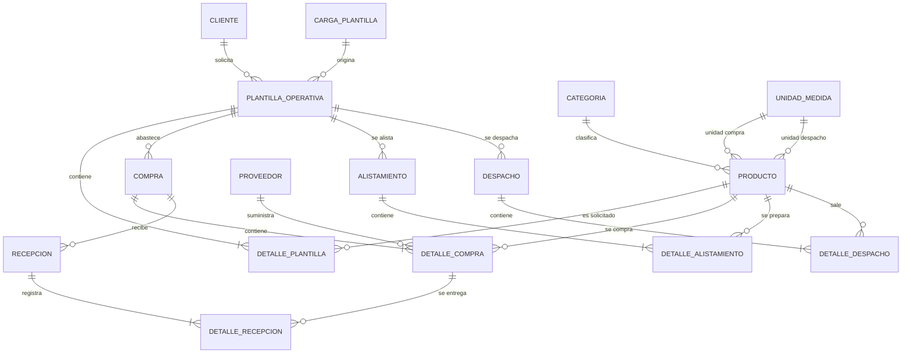

# Modelo entidad-relación — AGROMEDIO

## 1. Entidades y relaciones



**Leyenda:** `||` exactamente uno, `o{` cero o muchos, `|{` uno o muchos.

## 2. Tabla de relaciones

| Entidad origen | Cardinalidad | Entidad destino | Llave foránea | Comportamiento |
|---|---:|---|---|---|
| `cliente` | 1:N | `plantilla_operativa` | `id_cliente` | Restrict por defecto |
| `carga_plantilla` | 1:N | `plantilla_operativa` | `id_carga` | `ON DELETE RESTRICT` |
| `plantilla_operativa` | 1:N | `detalle_plantilla` | `id_plantilla` | `ON DELETE CASCADE` |
| `producto` | 1:N | `detalle_plantilla` | `id_producto` | Restrict por defecto |
| `categoria` | 1:N | `producto` | `id_categoria` | Restrict por defecto |
| `unidad_medida` | 1:N | `producto` | `id_unidad_compra` | Restrict por defecto |
| `unidad_medida` | 1:N | `producto` | `id_unidad_despacho` | Restrict por defecto |
| `plantilla_operativa` | 1:N | `compra` | `id_plantilla` | `ON DELETE RESTRICT` |
| `compra` | 1:N | `detalle_compra` | `id_compra` | `ON DELETE CASCADE` |
| `producto` | 1:N | `detalle_compra` | `id_producto` | Restrict por defecto |
| `proveedor` | 1:N | `detalle_compra` | `id_proveedor` | Restrict por defecto |
| `compra` | 1:N | `recepcion` | `id_compra` | `ON DELETE CASCADE` |
| `recepcion` | 1:N | `detalle_recepcion` | `id_recepcion` | `ON DELETE CASCADE` |
| `detalle_compra` | 1:N | `detalle_recepcion` | `id_detalle_compra` | Restrict por defecto |
| `plantilla_operativa` | 1:N | `alistamiento` | `id_plantilla` | `ON DELETE RESTRICT` |
| `alistamiento` | 1:N | `detalle_alistamiento` | `id_alistamiento` | `ON DELETE CASCADE` |
| `producto` | 1:N | `detalle_alistamiento` | `id_producto` | Restrict por defecto |
| `plantilla_operativa` | 1:N | `despacho` | `id_plantilla` | `ON DELETE RESTRICT` |
| `despacho` | 1:N | `detalle_despacho` | `id_despacho` | `ON DELETE CASCADE` |
| `producto` | 1:N | `detalle_despacho` | `id_producto` | Restrict por defecto |

## 3. Resumen de tablas

| Tabla | Propósito | PK |
|---|---|---|
| `cliente` | Entidad o mercado cliente | `id_cliente` |
| `categoria` | Clasificación de productos | `id_categoria` |
| `unidad_medida` | Catálogo de unidades | `id_unidad` |
| `proveedor` | Proveedores de productos | `id_proveedor` |
| `producto` | Catálogo maestro y conversión de unidades | `id_producto` |
| `carga_plantilla` | Historial de archivos importados | `id_carga` |
| `plantilla_operativa` | Solicitud operativa de un mercado | `id_plantilla` |
| `detalle_plantilla` | Productos y cantidades solicitadas | `id_detalle_plantilla` |
| `compra` | Cabecera de abastecimiento | `id_compra` |
| `detalle_compra` | Productos comprados y proveedor | `id_detalle_compra` |
| `recepcion` | Entrega recibida de una compra | `id_recepcion` |
| `detalle_recepcion` | Cantidades recibidas y faltantes | `id_detalle_recepcion` |
| `alistamiento` | Cabecera de preparación del mercado | `id_alistamiento` |
| `detalle_alistamiento` | Cantidades preparadas | `id_detalle_alistamiento` |
| `despacho` | Cabecera de salida | `id_despacho` |
| `detalle_despacho` | Verificación de productos despachados | `id_detalle_despacho` |

## 4. Funciones de búsqueda de productos implementadas

La interfaz `ProductoDAO` ahora incluye:

```java
List<Producto> buscar(String texto);
```

La implementación `ProductoDAOSqlite.buscar` realiza una búsqueda segura con `PreparedStatement`, ignorando mayúsculas/minúsculas y buscando coincidencias parciales en:

- nombre del producto;
- nombre de la categoría;
- nombre de la unidad de compra;
- nombre de la unidad de despacho;
- abreviatura de compra y despacho.

Ejemplo de uso:

```java
ProductoDAO dao = new ProductoDAOSqlite();
List<Producto> resultados = dao.buscar("arroz");
```

Si se envía `null` o texto vacío, devuelve todos los productos ordenados por nombre.

La búsqueda exacta que ya usaban los procesos existentes se mantiene:

```java
Producto producto = dao.buscarPorNombre("Leche entera pasteurizada");
```

## 5. Vistas de consulta

- `v_saldo_plantilla`: consolidado solicitado, alistado, comprado, recibido y despachado.
- `v_faltantes_recepcion`: faltantes acumulados por detalle de compra.
- `v_avance_despacho`: porcentaje de productos verificados por despacho.
